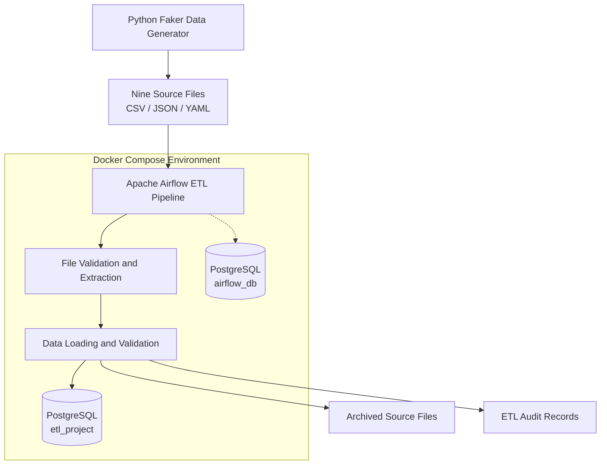
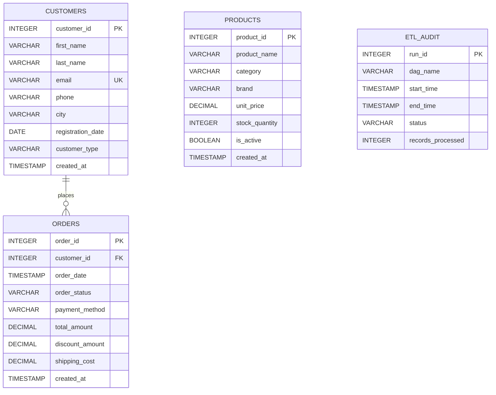
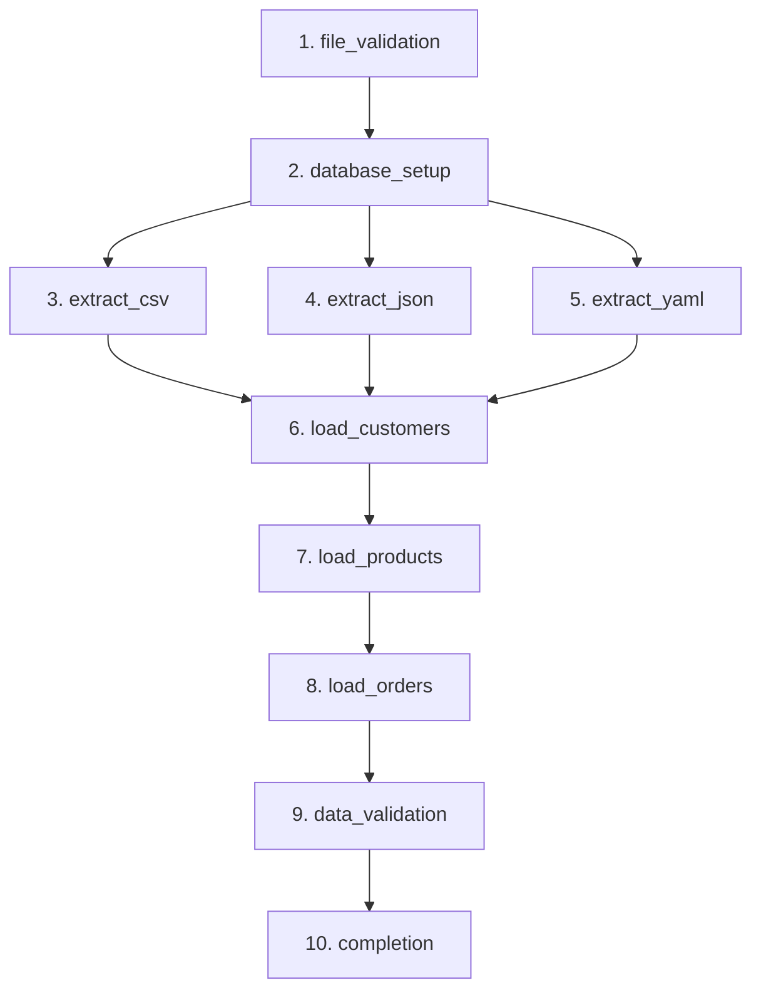

# Project 1: Rapid ETL Pipeline Development
## Technical Documentation

**Course:** DATA 430 – Data Engineering Practicum  
**Orchestration Tool:** Apache Airflow  
**Database:** PostgreSQL 16  
**Deployment Environment:** Docker Compose

---

## 1. Introduction

### 1.1 Project Purpose

The purpose of this project is to design, develop, and test an automated Extract, Transform, Load (ETL) pipeline capable of processing multiple data formats and loading validated records into a relational database. The project simulates a real-world data engineering environment in which reliable data processing, workflow scheduling, and error handling are essential.

The pipeline processes synthetic customer, product, and order information generated through the Python Faker library. Each dataset contains 1,000 records and is exported into CSV, JSON, and YAML formats, producing nine source files.

Apache Airflow coordinates the processing workflow, while PostgreSQL provides structured data storage. Docker Compose manages the application's services within a containerized environment.

### 1.2 Project Scope

The implemented solution includes:

- Synthetic data generation using Python and Faker.
- File validation and extraction from CSV, JSON, and YAML sources.
- Loading 3,000 unique records into PostgreSQL.
- Verification of database row counts and customer-order relationships.
- Daily workflow scheduling and manual execution through Apache Airflow.
- Error handling, execution logging, and successful and failed run auditing.
- Archiving processed source files for reference.

The project focuses on developing a functional proof-of-concept ETL pipeline rather than a production-scale data processing platform.

## 2. System Architecture

### 2.1 Architecture Overview

The system follows a containerized architecture consisting of three primary components: Apache Airflow, PostgreSQL, and shared data storage.

**Apache Airflow** is responsible for orchestrating the ETL process. Its scheduler determines when tasks execute, while its webserver provides an interface for monitoring and manually triggering pipeline runs. The project uses Airflow's LocalExecutor to execute tasks without requiring additional distributed worker services.

**PostgreSQL** serves two purposes. The `etl_project` database stores the generated customer, product, order, and audit information. A separate `airflow_db` database stores Airflow's internal scheduling and execution metadata.

**Docker Compose** defines and manages the PostgreSQL container and the Airflow initialization, webserver, and scheduler services. Shared volume mounts provide the Airflow containers with access to the project's DAG, SQL scripts, and source data files.

### 2.2 Architecture Diagram

The following diagram illustrates how the components interact:



### 2.3 Component Responsibilities

| Component | Responsibility |
|---|---|
| Python and Faker | Generate synthetic customer, product, and order records |
| pandas and PyYAML | Read and validate source files |
| Airflow Scheduler | Schedule and coordinate pipeline execution |
| Airflow Webserver | Provide monitoring and manual execution interface |
| Airflow LocalExecutor | Execute individual ETL tasks |
| PostgreSQL | Store business data and execution audit records |
| Docker Compose | Manage containers, networking, and persistent volumes |
| Shared Data Directory | Store original source files and archived copies |

### 2.4 Container Configuration

The project uses PostgreSQL 16 and Apache Airflow 2.10.5. The PostgreSQL container exposes port 5433 on the Mac, which maps to port 5432 inside Docker. The Airflow webserver is accessible through port 8080.

Database credentials are stored in a local `.env` file, which is excluded from Git version control. A `.env.example` file provides placeholder configuration values.

PostgreSQL data is stored in a persistent Docker volume so that database records remain available when containers are stopped and restarted.

## 3. Database Design

### 3.1 Database Overview

The ETL pipeline uses PostgreSQL 16 to store the processed customer, product, and order information. The `etl_project` database contains four tables: `customers`, `products`, `orders`, and `etl_audit`.

The database uses a relational structure to organize information, enforce unique identifiers, and maintain relationships between customers and their orders.

Each business data table includes a `created_at` timestamp that is automatically populated when records are inserted.

### 3.2 Database Tables

**Customers Table**

The `customers` table stores information about the 1,000 synthetic customers generated using Faker.

Its primary key is `customer_id`. The `email` column has a unique constraint to prevent duplicate email addresses.

| Column | Data Type | Description |
|---|---|---|
| customer_id | INTEGER | Primary key |
| first_name | VARCHAR(50) | Customer first name |
| last_name | VARCHAR(50) | Customer last name |
| email | VARCHAR(100) | Unique customer email |
| phone | VARCHAR(20) | Telephone number |
| city | VARCHAR(50) | Customer city |
| registration_date | DATE | Registration date |
| customer_type | VARCHAR(20) | Regular, Premium, or VIP |
| created_at | TIMESTAMP | Automatically generated insertion timestamp |

**Products Table**

The `products` table contains 1,000 product records, including descriptive information, pricing, inventory levels, and availability.

The `product_id` column serves as the primary key.

| Column | Data Type | Description |
|---|---|---|
| product_id | INTEGER | Primary key |
| product_name | VARCHAR(200) | Product name |
| category | VARCHAR(50) | Product category |
| brand | VARCHAR(50) | Product brand |
| unit_price | DECIMAL(10,2) | Unit price |
| stock_quantity | INTEGER | Available stock quantity |
| is_active | BOOLEAN | Product active status |
| created_at | TIMESTAMP | Automatically generated insertion timestamp |

**Orders Table**

The `orders` table stores 1,000 customer orders, including order dates, payment methods, amounts, discounts, and shipping costs.

The `order_id` column is the primary key. The `customer_id` column references the `customers` table through a foreign key relationship.

| Column | Data Type | Description |
|---|---|---|
| order_id | INTEGER | Primary key |
| customer_id | INTEGER | Foreign key to customers |
| order_date | TIMESTAMP | Order date and time |
| order_status | VARCHAR(20) | Pending, Shipped, or Delivered |
| payment_method | VARCHAR(30) | Payment method |
| total_amount | DECIMAL(10,2) | Order total |
| discount_amount | DECIMAL(10,2) | Discount amount |
| shipping_cost | DECIMAL(10,2) | Shipping charge |
| created_at | TIMESTAMP | Automatically generated insertion timestamp |

**ETL Audit Table**

The `etl_audit` table records pipeline execution information. It is used to monitor successful and failed runs.

| Column | Data Type | Description |
|---|---|---|
| run_id | SERIAL | Primary key for each audit entry |
| dag_name | VARCHAR(100) | Name of the Airflow DAG |
| start_time | TIMESTAMP | Recorded execution start time |
| end_time | TIMESTAMP | Recorded execution end time |
| status | VARCHAR(20) | Success or failure |
| records_processed | INTEGER | Number of records reported as processed |

### 3.3 Database Relationship Diagram

The following entity relationship diagram illustrates the database structure:



### 3.4 Referential Integrity

The relationship between customers and orders is enforced through a PostgreSQL foreign key constraint:

```sql
customer_id INTEGER REFERENCES customers(customer_id)
```

This prevents an order from referencing a nonexistent customer.

During execution, the pipeline loads customers before orders to satisfy this dependency. The final data validation task also checks for orders with invalid customer references.

The products table does not have a direct relationship with the orders table because the assignment's required order schema does not include a product identifier.

The `etl_audit` table is independent of the business data tables and maintains a history of pipeline outcomes.

## 4. ETL Data Flow

### 4.1 Pipeline Overview

The ETL pipeline is defined in `dags/etl_pipeline.py` and orchestrated using Apache Airflow 2.10.5. It consists of ten tasks that execute according to defined dependencies.

The workflow begins by validating source files and preparing the PostgreSQL database. Three extraction tasks then process the CSV, JSON, and YAML files in parallel. Once all extraction tasks succeed, the pipeline loads customer, product, and order records sequentially, validates the results, and completes the execution.

The DAG is scheduled to run daily using `@daily` and also supports manual triggering through the Airflow web interface. The `catchup=False` configuration prevents automatic backfilling of earlier scheduled intervals.

### 4.2 Task Execution Diagram



### 4.3 Task Descriptions

| Task | Description |
|---|---|
| file_validation | Confirms that all nine source files exist, can be read, and contain 1,000 records each |
| database_setup | Creates database tables if necessary and clears existing business data before reloading |
| extract_csv | Reads and validates the customer, product, and order CSV files |
| extract_json | Reads and validates the customer, product, and order JSON files |
| extract_yaml | Reads and validates the customer, product, and order YAML files |
| load_customers | Inserts 1,000 customer records into PostgreSQL |
| load_products | Inserts 1,000 product records into PostgreSQL |
| load_orders | Inserts 1,000 order records into PostgreSQL |
| data_validation | Verifies database row counts and valid customer-order relationships |
| completion | Archives source file copies and records successful pipeline completion |

### 4.4 Extraction and Loading Strategy

The nine source files contain three representations of each dataset. For example, `customers.csv`, `customers.json`, and `customers.yaml` contain the same 1,000 customer records.

The pipeline validates all three formats but uses CSV as the source for database insertion. This design prevents duplicate records from being inserted when the same information appears in multiple formats.

The extraction tasks verify file readability and record counts. The loading functions subsequently read the CSV files and insert their records into PostgreSQL using the `psycopg2` library.

Customer records are loaded first, followed by products and orders. Loading customers before orders ensures that referenced customer IDs already exist when PostgreSQL applies the foreign key constraint.

### 4.5 Data Validation and Completion

After loading, the `data_validation` task confirms that the customers, products, and orders tables each contain exactly 1,000 records. It also checks that every order references an existing customer.

The `completion` task then creates timestamped archive copies of the nine original source files and inserts a successful execution record into the `etl_audit` table.

The original source files are retained so the pipeline can execute again without requiring immediate regeneration of the data.

## 5. Key Design Decisions

### 5.1 Selection of Apache Airflow

Apache Airflow was selected as the orchestration platform because it supports Python-based workflow development, task dependencies, and automated scheduling. Using Python also allowed the project to build on existing programming skills and integrate with pandas and PostgreSQL.

Airflow's Directed Acyclic Graph (DAG) structure provides a clear representation of the ETL process. Each task has a defined responsibility, making the workflow easier to monitor and troubleshoot.

### 5.2 Containerization with Docker

Docker Compose was used to create a consistent execution environment for Apache Airflow and PostgreSQL. Containerization reduces differences between development environments by allowing the application services to run with specified software versions and configurations.

The PostgreSQL database uses persistent Docker storage to preserve records when containers are stopped. Shared volume mounts allow Airflow to access the generated data files, Python scripts, and SQL schema.

### 5.3 PostgreSQL Database Design

PostgreSQL was selected because it supports relational database structures, primary keys, foreign keys, unique constraints, and transactions.

Separate databases were created for Airflow metadata and the project's ETL data. This separation prevents Airflow's internal scheduling tables from becoming mixed with the customer, product, order, and audit tables.

### 5.4 Data Format and Loading Strategy

The project generates each dataset in CSV, JSON, and YAML formats to demonstrate the ability to work with multiple data representations.

All nine files are validated during extraction. However, CSV was selected as the primary format for database loading because the three formats contain equivalent datasets. Loading from only one representation prevents duplicate records and simplifies data insertion.

The pipeline uses pandas for reading and validating data and psycopg2 for inserting records into PostgreSQL.

### 5.5 Task Dependencies and Data Integrity

Task dependencies were designed to maintain the correct execution sequence.

File validation must succeed before database preparation begins. All three extraction tasks must finish successfully before customer loading starts.

Customers are loaded before orders because the orders table contains a foreign key referencing the customers table. Products are loaded between customers and orders to follow the required pipeline sequence.

This approach reduces the risk of incomplete processing and foreign key violations.

### 5.6 Database Reload Strategy

The pipeline clears existing customer, product, and order records before each execution and reloads the complete datasets.

This full-refresh approach prevents duplicate records from accumulating during repeated pipeline runs. It is appropriate for the project's small datasets and proof-of-concept requirements.

However, this design would be less suitable for a production environment containing large datasets or requiring historical business records. A production solution could use incremental loading or upsert operations instead.

### 5.7 Logging and Audit Design

Airflow provides task-level execution logs, allowing individual failures to be investigated. The pipeline also uses Python logging statements to record processing results and errors.

The `etl_audit` table provides database-level records of successful and failed pipeline runs.

The completion task records successful executions, while an Airflow DAG failure callback records unsuccessful executions. This allows the project to demonstrate basic operational monitoring and failure recovery.

The current implementation records zero processed records for failed runs because partial processing counts are not tracked. Successful-run timestamps are generated during the completion task rather than taken directly from Airflow's DAG execution metadata. These are limitations that could be addressed in a future version.

## 6. Error Handling and Testing

### 6.1 Error Handling Strategy

The ETL pipeline incorporates error handling at the file, database, and workflow levels to identify processing problems and prevent invalid data from continuing through the pipeline.

**File-Level Error Handling**

The `file_validation` task verifies that all nine source files exist, can be read, and contain exactly 1,000 records each. Missing files, unreadable data, and incorrect record counts cause the task to fail.

Each extraction task uses exception handling to identify errors when reading CSV, JSON, or YAML files. Failed tasks generate error messages in the Airflow logs.

**Database-Level Error Handling**

The loading functions use PostgreSQL transactions to manage database operations. When a loading operation succeeds, the transaction is committed. If an exception occurs, the transaction is rolled back to prevent partially inserted records from that task from being committed.

PostgreSQL also enforces primary key, unique email, and foreign key constraints to help preserve data integrity.

**Workflow-Level Error Handling**

Apache Airflow monitors the status of each task and prevents dependent tasks from executing when upstream tasks fail.

The DAG is configured to retry a failed task once, with a one-minute delay. If the DAG ultimately fails, its failure callback records the unsuccessful execution in the `etl_audit` table.

### 6.2 Data Validation

Data validation takes place at multiple stages of the ETL process.

Before loading begins, the pipeline verifies the presence and readability of all nine source files. Each file must contain exactly 1,000 records.

The customer-loading function checks for duplicate customer IDs and email addresses. The product-loading and order-loading functions check for duplicate primary key values.

After loading, the `data_validation` task queries PostgreSQL to verify that the customers, products, and orders tables each contain exactly 1,000 records.

The task also checks for orders referencing nonexistent customers. A successful validation confirms that the expected records were loaded and that the customer-order relationships are valid.

### 6.3 Successful Execution Testing

The complete Airflow pipeline was executed successfully using the manual trigger feature.

All ten tasks completed successfully, and PostgreSQL returned the following record counts:

| Database Table | Expected Records | Actual Records | Result |
|---|---:|---:|---|
| customers | 1,000 | 1,000 | Passed |
| products | 1,000 | 1,000 | Passed |
| orders | 1,000 | 1,000 | Passed |
| **Total** | **3,000** | **3,000** | **Passed** |

Repeated executions were also tested. The database continued to contain exactly 1,000 records in each business table, confirming that the full-refresh approach prevented duplicate accumulation.

### 6.4 Controlled Failure Testing

A controlled failure test was performed to verify the pipeline's error handling and failure auditing.

The `customers.csv` file was temporarily renamed to `customers_test_backup.csv`, making the required source file unavailable to Airflow.

The pipeline was manually triggered. The `file_validation` task detected the missing file and failed. After the configured retry, Airflow marked the DAG run as failed.

The DAG failure callback successfully inserted a record into PostgreSQL's `etl_audit` table with a status of `failed` and zero records processed.

The original filename was restored immediately after the test.

### 6.5 Failure Recovery Testing

After restoring `customers.csv`, the pipeline was triggered again.

All ten tasks completed successfully, and the completion task recorded 3,000 processed records in `etl_audit`.

The audit history demonstrated the following execution sequence:

| Run ID | Status | Records Processed |
|---|---|---:|
| 1 | success | 3,000 |
| 2 | success | 3,000 |
| 3 | failed | 0 |
| 4 | success | 3,000 |

These results confirmed that the pipeline could detect a missing source file, record the failure, and execute successfully after the issue was corrected.

### 6.6 Testing Limitations

Testing focused on the functional requirements of the project, including valid source files, database loading, referential integrity, repeated execution, and missing-file recovery.

Automated unit and integration test suites were not implemented. Additional testing could examine corrupted files, database connection failures, larger datasets, and performance under increased workloads.

The current database reload strategy also does not provide a single transaction covering the entire pipeline. Individual loading tasks commit separately, so a failure after some loading tasks succeed could leave partially refreshed data until the next successful run.

## 7. Conclusion

### 7.1 Project Summary

The Rapid ETL Pipeline Development project successfully demonstrated the design and implementation of an automated data processing workflow using Apache Airflow, Python, PostgreSQL, and Docker Compose.

The pipeline processes synthetic customer, product, and order data generated with the Faker library. Each dataset contains 1,000 records represented in CSV, JSON, and YAML formats. All nine source files are validated before the pipeline loads 3,000 unique records into PostgreSQL.

The completed Airflow DAG consists of ten tasks responsible for file validation, database preparation, data extraction, database loading, data validation, and pipeline completion. Task dependencies ensure that processing occurs in the correct sequence and that orders are loaded only after their referenced customers exist.

Testing confirmed that the pipeline could successfully load and validate all required records, execute repeatedly without accumulating duplicates, and recover from a controlled file validation failure. The `etl_audit` table also successfully recorded both completed and failed executions.

### 7.2 Lessons Learned

Developing this pipeline demonstrated the importance of configuring the development environment correctly, managing dependencies between tasks, and validating data at multiple stages.

Containerization provided a consistent environment for Airflow and PostgreSQL, while Airflow's task logs and graphical interface made it easier to identify and troubleshoot errors.

The project also reinforced the importance of testing individual components before running the entire workflow. This incremental approach helped identify configuration problems and verify each stage before additional functionality was introduced.

### 7.3 Future Improvements

Although the current implementation meets the project's primary functional requirements, several improvements could make it more suitable for production environments.

Potential enhancements include automated unit and integration tests, incremental data loading, bulk database inserts, and additional monitoring capabilities.

The deployment process could also be improved by automating initial database creation and configuration. More detailed execution auditing could capture accurate DAG start and end times, partial processing counts, and additional error information.

A future version could also implement stronger recovery procedures to prevent partially refreshed datasets if a failure occurs after loading has begun.

Overall, the project provides a functional proof of concept for orchestrating a multi-format ETL workflow while demonstrating essential data engineering practices.